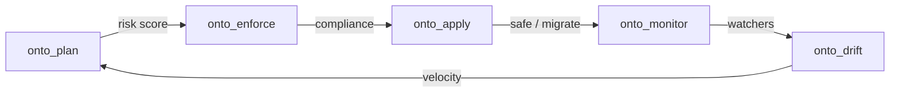

# Ontology Lifecycle

Production ontologies change over time. Open Ontologies provides Terraform-style lifecycle management.



## Plan

Diffs current vs proposed ontology. Reports added/removed classes, properties
and **individuals**, the triple-level delta, blast radius, and a risk score
(`low`/`medium`/`high`). Locked IRIs (`onto_lock`) prevent accidental removal.

The proposed Turtle is the complete desired state, as in Terraform: anything
absent from it is removed. The plan therefore reports instance data as well as
the TBox, because an apply deletes both — a removal of any kind is at least
`medium` risk, and `high` once other triples reference it.

Every plan is persisted in the state database and returned as a `plan_id`. Plans
therefore survive the process that computed them: `plan` and `apply` are
separate CLI invocations and separate MCP calls, and neither shares memory with
the other. The 100 most recent plans are retained.

### Conservativity: what the change means

Everything above is about SHAPE. A change that adds one `rdfs:domain` triple adds
no class, removes nothing, has a blast radius of zero and scores `low`, while
retyping every existing individual of that property. The `conservativity` block
reports whether the change alters any consequence over the names the store
already uses, with the rule and the premises the base lacked behind every row.

It is on by default since #196 and costs a fixpoint over both graphs; skip it with
`--no-conservativity` (CLI and `batch`) or `check_conservativity: false`
(`onto_plan`). When it is off the `conservativity` block is still there and reads
`ran: false` with the reason: a missing block and a clean block look the same to a
dashboard. It is never fatal; a check that cannot run leaves
`conservativity.skipped` set and the plan is still returned. The verdict is a WORD
rather than a boolean, and it is conservativity with respect to a Horn rule table
rather than in a description logic, which
[docs/modules-and-conservativity.md](modules-and-conservativity.md) states in
full.

### Logic: what the change breaks

Conservativity does not see a change that breaks the ontology. Adding
`Manager rdfs:subClassOf Person` and `Manager owl:disjointWith Agent`, where
every `Person` is an `Agent`, leaves `Manager` with no possible instance; adding
`Machine owl:disjointWith Person` and `alice a Machine`, where `alice` is a
`Person`, makes the ABox inconsistent. Both remove nothing and both used to score
`low` (#336). The `logic` block answers this, relative to the store, so a defect
the store already had is never charged to the change:

| field | meaning |
|---|---|
| `new_defects` | findings of the eight `defects` kinds in the proposed graph that the store did not have; `null` if the check could not run |
| `new_defects_by_severity`, `new_defect_findings` | the same, by severity, and listed (at most 50) |
| `abox_consistent` | the owl-dl tableaux on the proposed graph: `false` on a clash it found, `true` only when the search finished and the graph uses no construct the tableaux does not model, otherwise `null` |
| `abox_consistent_before` | the same question of the store, asked only when the proposed graph is inconsistent; `null` otherwise |
| `checked_by`, `reason` | what ran, and in words why each answer is what it is; `not_checked` when skipped |

A new `error` or `warning` defect, or an inconsistency the store was not proven to
have, sets `risk_score` to `high`, and `risk_reasons` says which. An `info`
finding is listed and does not move the score. The consistency half runs under
the `[reasoner]` budget (`tableaux_test_timeout_ms` per phase, under
`classify_timeout_ms`), and a run that exhausts it reports `null` with the reason,
never `true`. Skip the whole block with `--no-logic-check` or
`check_logic: false`.

The exit code of `plan` does not change with the verdict: it is 1 on an error and
0 otherwise, as it always was for a `high` score from removals. A pipeline gates
on `risk_score` or `logic`.

## Enforce

Design pattern checks. Built-in packs: `generic` (orphan classes, missing labels), `boro` (IES4/BORO compliance), `value_partition` (disjointness). Custom SPARQL rules supported.

## Apply

Two modes: `safe` (write the delta) or `migrate` (same, plus
owl:equivalentClass/Property bridges for consumers).

Apply does not re-judge the plan. It applies a plan whatever its `risk_score` or
`logic` block said, and the only gate is the monitor (`force` skips that too). A
change that removes terms on purpose has always been applicable at `high`, and an
apply that began refusing on a field it never read would break the pipelines
built on it without a word.

Apply writes only the triples that differ, so an unchanged graph costs nothing
and a one-instance change touches one triple. `strategy` reports `delta`, or
`reload` when blank nodes are present anywhere in either graph: bnode labels are
store-local, so a set difference over them is meaningless and `DELETE DATA` /
`INSERT DATA` cannot carry them at all. The result is the same either way.

Applies the most recent plan by default. Pass a `plan_id` (`--plan-id` on the
CLI, `plan_id` to `onto_apply`) to apply a specific one; an id that does not
match a stored plan is an error rather than a silent fall-back to the latest.

"Most recent" is scoped to whoever computed the plan: one MCP session, or the
CLI as a whole. A single state db is shared by every session in HTTP mode, so an
unscoped default would let one session apply changes another was still
reviewing. Naming a `plan_id` still reaches across deliberately, and the error
says so when plans exist but belong to someone else.

```bash
oo plan proposed.ttl                    # prints plan_id
oo apply safe --plan-id plan-0a1b2c3d…  # or just: oo apply safe
```

### Rename bridges

`migrate` pairs each removed term with a replacement using `DriftDetector`, the
same calibrated rename detector `onto_drift` uses, assigned one-to-one so no
addition can be declared the replacement for two different removals. Pairs below
a name/label similarity of 0.6 are declined.

`owl:equivalentClass` is a hard logical assertion, so a wrong bridge is worse
than a missing one. Every bridge is reported with its similarity score in
`bridges`, and every removal the matcher declined is named in
`unbridged_removals` — check both before trusting a migration.

## Monitor

SPARQL watchers with threshold alerts. Actions: `notify`, `block_next_apply`, `auto_rollback`, `log`.

## Drift

Compares versions, detects renames via Jaro-Winkler similarity, computes drift velocity. Self-calibrating confidence via SQLite feedback loop.

## Lineage

Append-only audit trail of all lifecycle operations.

## Feedback

Lint and enforce learn from your decisions. Dismiss a warning 3 times and it's suppressed; accept it once and it sticks. Same self-calibrating pattern used by `align` and `drift`.
